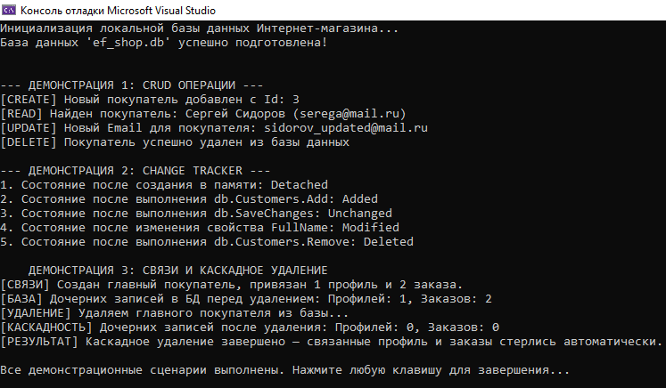

Проект представляет собой адаптацию учебного шаблона под предметную область Интернет-магазин. В качестве СУБД используется встроенная SQLite. Связи между таблицами настроены через Entity Framework Core, выборка данных реализована с помощью запросов LINQ.

## Архитектура и структура проекта
```text
EFTemplate/
│
├── Models/                 # Слой сущностей (Таблицы БД)
│   ├── Customer.cs            # Покупатели (главная сущность)
│   ├── CustomerProfile.cs     # Профили покупателей (связь 1:1 к Customer)
│   └── Order.cs               # Заказы покупателей (связь 1:N к Customer)
│
├── Data/                   # Слой доступа к данным
│   ├── AppDbContext.cs        # Контекст БД (настройка подключения к SQLite)
│   └── DbInitializer.cs       # Первичная генерация БД и сидирование данными
│
├── Demos/                  # Практические сценарии работы с EF Core
│   ├── CrudOperations.cs   # Операции создания, чтения, обновления и удаления
│   ├── ChangeTracker.cs    # Демонстрация состояний жизненного цикла объектов
│   └── Relationships.cs    # Работа со связями и каскадное удаление
│
├── Program.cs              # Точка входа: вызов инициализации и запуск демонстраций
├── .gitignore              # Исключение временных папок (bin, obj, .vs) и файла БД
└── README.md               # Документация
```

# Шаблон практической работы: Введение в Entity Framework Core

Учебный проект для знакомства с технологией ORM на примере Entity Framework Core и локальной базы данных SQLite.

## Требования для запуска
* Visual Studio 2026
* Платформа .NET 10.0 или выше
* Установленный через NuGet пакет Microsoft.EntityFrameworkCore.Sqlite

## Реализованная архитектура и связи

В папке Models спроектированы 3 сущности:
1. Customer.cs (Покупатель) — главная сущность.
2. CustomerProfile.cs (Профиль покупателя) — хранит адрес и телефон. Связан с покупателем связью один-к-одному (1:1).
3. Order.cs (Заказ) — хранит дату и сумму заказа. Связан с покупателем связью один-ко-многим (1:N).

## Продемонстрированные сценарии (Папка Demos)

1. 01_CrudOperations.cs — добавление записи в базу данных, поиск по первичному ключу, обновление текстового поля и последующее ручное удаление.
2. 02_ChangeTracker.cs — пошаговый вывод состояний жизненного цикла сущности в контексте данных: Detached, Added, Unchanged, Modified, Deleted.
3. 03_Relationships.cs — одновременное создание дерева связанных объектов и проверка механизма автоматического каскадного удаления всех дочерних строк при удалении родительской записи покупателя.

## Результат выполнения программы

